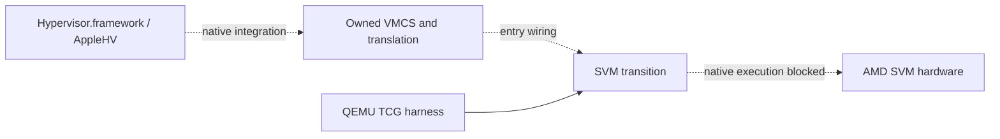

<div align="center">

# AMDHV

**Experimental Intel VMX → AMD SVM translation for macOS.**

[](https://github.com/mxtpasontop/AMDHV/actions/workflows/check.yml)


[Build](#build) · [Tests](#tests) · [Architecture](#architecture) · [Roadmap](docs/IMPLEMENTATION.md) · [Contributing](CONTRIBUTING.md)

</div>

> **100% AI-made.** AMDHV's original source code, tests, and documentation were
> generated entirely by AI assistants under human direction. Third-party
> dependencies retain their own authorship and licenses.

> **Diagnostic only.** AMDHV does not yet provide working Hypervisor.framework
> virtualization on AMD hardware. Full translation and trap installation are
> blocked, and the framework entry returns failure. Earlier experimental builds
> caused immediate boot crashes. Passing model or emulator tests does not make
> this a boot-ready virtualization backend.

## What is AMDHV?

macOS's AppleHV backend uses Intel VMX interfaces. AMDHV explores translating
those interfaces into AMD SVM while preserving host state, guest isolation and
memory ownership. It is implemented as an x86_64 [Lilu](https://github.com/acidanthera/Lilu)
plugin, with bounded software VMCS state, shadow nested page tables and a separate
experimental SVM transition.

The current public milestone is a **diagnostic kext and tested translation
infrastructure**. It includes:

- **Retained ownership:** vCPU/VMCS descriptor leases, source-map wiring, lifetime
  epochs and teardown protection for idle and active vCPUs.
- **Memory isolation:** ownership-checked EPT walks, 4KiB shadow leaves, revoked
  mapping updates, bounded ASIDs and explicit shootdown failure handling.
- **Guarded emulation:** bounded VMX decoding, owned operands, exact-site fault
  recovery and a trap adapter that still needs its native code-image provider.
- **CPU lifecycle models:** reversible SVM setup/restore, partial-failure rollback,
  suspend/resume and separate CPU readiness/ownership tracking.
- **An emulated transition:** production SVM assembly tested inside QEMU TCG,
  including failed entry, fault recovery, NPF, host-timer cancellation and 1,000
  repeated host restores.
- **Reproducible diagnostics:** pinned dependencies, selected binary ABI evidence,
  source/artifact identities and staged, validated kext packaging.

See the [implementation status](docs/IMPLEMENTATION.md) for the complete list of
implemented components and missing dependencies. Every execution-acceptance gate
in [BackendPolicy.hpp](src/BackendPolicy.hpp) remains false.

## Build

### Requirements

- An **x86_64 Mac** with Xcode command-line tools and a macOS SDK.
- Python **3.10 or newer**, Git and Make.
- Network access for the initial pinned dependency fetch.
- A TCG-capable QEMU binary only if running the emulation harness.

```sh
git clone https://github.com/mxtpasontop/AMDHV.git
cd AMDHV

# Fetch the exact Lilu and MacKernelSDK revisions in dependencies.lock.json.
python3 tools/dependencies.py --fetch

# Build the diagnostic kext and run source checks using available logical CPUs.
make -j"$(sysctl -n hw.logicalcpu)" check kext
```

The output is `build/AMDHV.kext`, including
`Contents/Resources/BuildManifest.json` with the source identity, executable UUID,
hashes, dependency revisions and reviewed ABI evidence.

**Building never installs the kext, changes EFI or edits boot arguments.**
Dependencies are fetched into the ignored `vendor/` directory; they are not copied
into this repository. Subsequent dependency checks run without fetching.

Production objects compile independently. `make -j12` is appropriate for a
12-thread system; small two-CPU test fixtures do not limit the backend. The
current CPU bound is 128, with tests covering 12-CPU lifecycle models and
12 concurrent workers.

## Tests

| Command | Coverage |
| --- | --- |
| `make check` | Five C++ suites, Python tooling tests, shell syntax and plist checks |
| `make -j12 sanitize thread-sanitize` | Address/undefined-behavior sanitizers and thread-sanitized runtime tests |
| `make -j12 test BUILD_DIR=build/ndebug TEST_EXTRA_FLAGS=-DNDEBUG` | The C++ suites with assertions disabled |
| `python3 tools/emulate_transition.py --qemu /path/to/qemu-system-x86_64` | Production transition assembly inside a software CPU |
| `make hv_smoke_test` | Build and sign the future live-test executable; does not run it |

The recorded local validation includes **65 main translation checks, 31 Python
tests**, exhaustive short-buffer decoder coverage and 100,000 deterministic
longer decoder inputs. The latest documented results are in
[VALIDATION.md](docs/VALIDATION.md); the badge above shows the separate GitHub
Actions result for `main`.

The TCG harness runs independently of `kern.hv_support` and does not execute
physical host SVM instructions. With the local emulator built at the default
path, `make emulate-transition` runs it directly. For setup, exact provenance and
known emulator limitations, see [EMULATION.md](docs/EMULATION.md).

## Architecture

The intended native flow is shown below. Dotted connections remain incomplete
or disabled; the QEMU harness exercises the transition separately.



| Area | Main components |
| --- | --- |
| Plugin and compatibility | `AMDHV`, `AppleHVABI`, `Compatibility`, `BackendPolicy` |
| Object and CPU ownership | `VcpuLifecycle`, `SpaceLifecycle`, `HostLifecycle`, `SVMCPU` |
| VMX instruction handling | `InstructionDecoder`, `SoftVMCS`, `TrapAdapter`, `FaultMemory`, `TrapRecovery` |
| Guest memory and isolation | `GuestMemory`, `EPTSource`, `NPTManager` |
| State conversion and transition | `VMCBTranslator`, `SVMTransition`, `SVMEntry` |
| Native services | `XNUPlatform` |

## Diagnostics and compatibility

Preflight is pinned to the exact identities in
[config/compatibility.json](config/compatibility.json), currently Darwin 25.6.0.
The selected instruction spans in [config/abi.json](config/abi.json) are checked
against the installed kernel and AppleHV images. Matching these contracts is a
compatibility check, not proof of the entire private ABI or hardware support.
Changing UUIDs or using `-amdhvbeta` does not establish compatibility.

| Boot mode | Behavior |
| --- | --- |
| `amdhvmode=bootstrap` | Default. Publishes service diagnostics without Lilu callbacks |
| `amdhvmode=preflight` | Checks kernel/AppleHV identities, selected instruction spans and symbols; installs no hooks |
| `amdhvmode=trap` | Reports `blocked-backend` |
| `amdhvmode=full` | Reports `blocked-backend` |

`-amdhvoff` disables the plugin; `-amdhvdbg` enables debug logs. Legacy
`amdhvstage=0/1/2/3` maps to the same modes, and conflicting arguments are rejected.
Diagnostic mode expects **`kern.hv_support = 0`** and skips guest execution.

Read-only checks on a compatible system:

```sh
python3 tools/verify_abi.py
python3 tools/check_symbols.py --lilu /path/to/Lilu.kext/Contents/MacOS/Lilu

# For a separately installed diagnostic build after reboot:
./test_after_reboot.sh --diagnose-only --expect-mode preflight
```

Post-reboot checks compare the loaded source identity and executable UUID with
the local bundle, verify the requested mode, and save private current-boot records
under `diagnostics/`. An older installed binary is expected to fail this
comparison. When the local bundle is unavailable, supply `--expect-build` and
optionally `--expect-uuid` explicitly.

## Roadmap

The next dependencies are:

1. Native code-image/instruction-site ownership and safe operand-write contracts.
2. A setup, drain, deferred-free, hotplug and synchronous-flush coordinator.
3. Framework entry/MSR integration with retained vCPU, CPU-run and NPT leases.
4. Complete guest-state, interrupt/event, timer and required control semantics.
5. Staged kernel/hardware acceptance before lifting any execution gate.

The detailed [six-phase plan](docs/IMPLEMENTATION.md) separates these software
dependencies from the hardware tests. A reboot alone cannot complete the backend.

## Repository layout

```text
src/                   Kext, translation, ownership and platform code
Headers/Lilu/          Production header adapters and userspace test doubles
config/                Pinned compatibility, ABI and import policies
tests/                 Offline regression suites and freestanding TCG harness
tools/                 Dependency, packaging, diagnostics and verification tools
docs/                  Implementation status, validation and emulation guide
.github/workflows/     macOS checks and Linux TCG validation
```

`build/`, `vendor/` and `diagnostics/` are local and ignored. `make clean` preserves
local checkpoints, research and the emulator under `build/`. Preview diagnostic
record pruning with `python3 tools/records.py --keep 20`; add `--apply` to delete
only the listed records. EFI/config backups are outside that tool's scope.

## Contributing and licensing

See [CONTRIBUTING.md](CONTRIBUTING.md) for testing expectations and useful bug
reports. Reports should distinguish model results, TCG execution, diagnostic
boots and actual hardware acceptance.

A project redistribution license has not been selected. No MIT, GPL or other
project license is implied. Pinned third-party dependencies retain their own
licenses; consult the upstream repositories.
